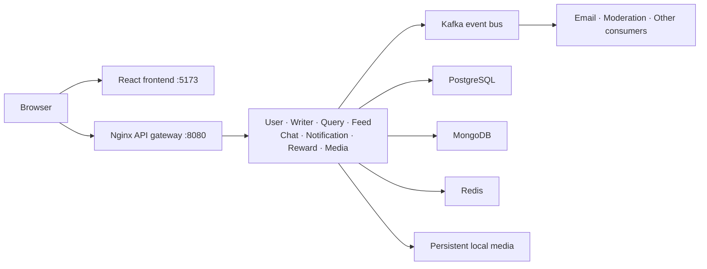
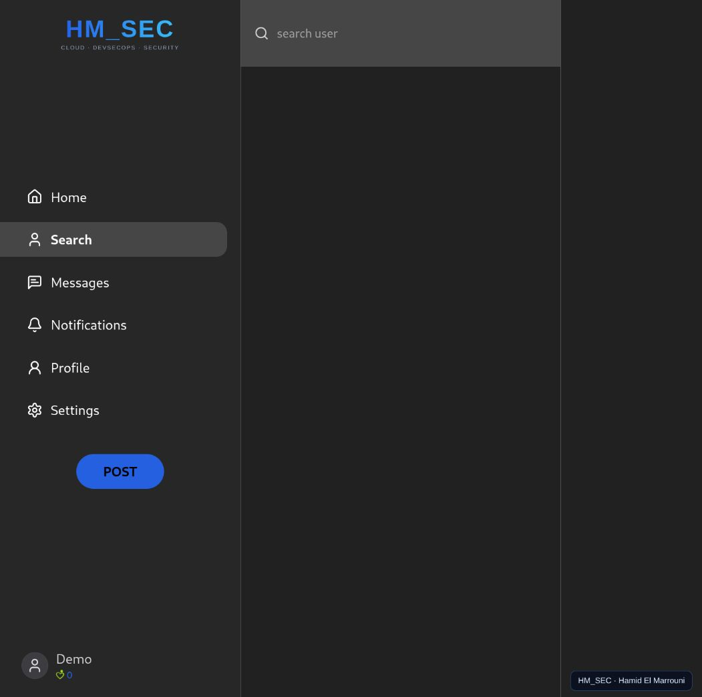

# HM-SEC

A portable local deployment of the social application, packaged with Docker Compose and an optional Kubernetes/k3d lab.

HM-SEC brings the frontend, ten backend services, gateway, databases, and deployment tooling into one repository. The application is derived from Humane; HM-SEC focuses on packaging, local deployment, and infrastructure. See [THIRD_PARTY.md](THIRD_PARTY.md) and the original [ISC license](LICENSE).

## Run locally

Install **Docker with Docker Compose** and **Python 3.9 or newer**. Start Docker before continuing. No host Node.js, npm, database, cloud account, or prebuilt HM-SEC images are required.

```sh
python3 scripts/hmsec.py up
```

On Windows PowerShell, use `py -3 scripts/hmsec.py up`. Run Docker Desktop with **Linux containers**. The same Python launcher is intended for Linux, macOS, and Windows; see the validation report for platforms actually tested.

Open **http://127.0.0.1:5173**. Sign in with `HMSEC_SEED_EMAIL` and `HMSEC_SEED_PASSWORD` from `runtime/.env.docker`. The first run generates a different password and four authentication secrets for each checkout. Keep this file private. Demo users and the local admin share this generated password.

The first build downloads public images and locked npm dependencies. Allow several minutes, more on a slow connection. This is a full microservices stack: plan for around **8 GB of available Docker memory and 15 GB of free disk** as a starting budget, not a measured minimum. A 16 GB host is preferable. ARM64, macOS, and Windows have not yet been verified; image and native dependency compatibility must be checked there. This does not run on literally every machine.

| Command | Purpose |
| --- | --- |
| `python3 scripts/hmsec.py init` | Generate private local configuration without starting services |
| `python3 scripts/hmsec.py check` | Validate Compose configuration without exposing secret values |
| `python3 scripts/hmsec.py build` | Build all application images from this repository |
| `python3 scripts/hmsec.py up` | Build, initialize databases, start, and wait for health checks |
| `python3 scripts/hmsec.py test` | Check login, refresh, queries, sockets, and media |
| `python3 scripts/hmsec.py status` | Show services and initialization jobs |
| `python3 scripts/hmsec.py logs` | Show recent service logs; review before sharing |
| `python3 scripts/hmsec.py stop` | Stop services while retaining containers and data |
| `python3 scripts/hmsec.py down` | Remove project containers/networks while retaining data volumes |

Run commands inside the repository. The launcher resolves paths relative to itself, so moving the folder does not break it. Avoid running two copies with the same default Compose project name and ports. Database credentials belong to their existing volumes: changing the environment file does not rotate credentials inside an already initialized database.

## Architecture



- **Frontend:** React, TypeScript, Vite, Tailwind CSS.
- **Backend:** Node.js/TypeScript services; Socket.IO for chat and notifications.
- **Data:** PostgreSQL with separate user/reward schemas, MongoDB replica set, Redis, Kafka.
- **Edge:** Nginx gateway and a separate frontend container. Only ports 5173 and 8080 are published, on loopback by default.
- **Persistence:** Docker volumes for databases, Kafka logs, and uploaded media.
- **Optional orchestration:** Kubernetes manifests, probes, RBAC, NetworkPolicies, PVCs, and local k3d tooling.

The local query service uses MongoDB; this Compose stack does not deploy Elasticsearch, Grafana, or a production AI moderation pipeline.

## Local demo boundaries

This configuration is a development/demo lab. Email goes to console logs, Google OAuth is disabled, moderation auto-approves, and the development OTP is fixed. Local media upload is unauthenticated. Keep the default loopback bindings; production deployment needs a separate authentication, TLS, media-access, secret-management, and operations review. See [SECURITY.md](SECURITY.md).

To use another host name or LAN address, set `HMSEC_PUBLIC_HOST` and the bind settings in `runtime/.env.docker`, then rerun `up`. Frontend API URLs are injected when the container starts. Changing bind settings exposes the demo to that network.

## Kubernetes lab

`k8s/` holds the baseline manifests. `deploy/k3d/` holds the optional Linux-only local cluster tooling. It defaults to **one shared logical CPU**, inherited from the supplied lab; it is intentionally slow and is not a production sizing recommendation.

From the repository root:

```sh
python3 scripts/hmsec.py build
cd deploy/k3d
./INSTALL.sh
./UP.sh
```

The installer can install system packages and downloads verified local tools. Review it before running. `UP.sh` switches off this project's Compose services and starts a separate cluster/data set; it does not migrate Compose data. Source paths now default to the repository root. Read [the k3d guide](deploy/k3d/README.md) for requirements and mode switching. Kubernetes live deployment is a separate verification step from Compose testing.

## Repository layout

```text
frontend/             Browser application
*-service/            Backend services
humane-common/        Included shared-source reference (services use locked npm package)
docker/               Gateway and database initialization
scripts/              Portable launcher and application smoke tests
k8s/                  Kubernetes baseline manifests
deploy/k3d/           Optional local Kubernetes tools and regression tests
docs/                 Current verification and screenshots
Docs/                 Upstream architecture and design references
runtime/              Private local state (excluded from Git except empty media directory)
```

No Git submodule initialization is needed. Dependencies use the committed package lockfiles and `npm ci`. Base image tags are versioned but not digest-pinned; builds are not claimed to be bit-for-bit reproducible.

## Publish to GitHub

Follow [UPLOAD_TO_GITHUB.md](UPLOAD_TO_GITHUB.md) to create an empty public repository and push over SSH. The helper uploads only committed source files.

## Verification

See [docs/VALIDATION.md](docs/VALIDATION.md) for the checks actually completed. GitHub Actions runs configuration and offline Kubernetes tests; the separate manual integration workflow builds and exercises the full stack.

## Local preview

Verified demo login on Linux; the new local data set starts with an empty feed.


